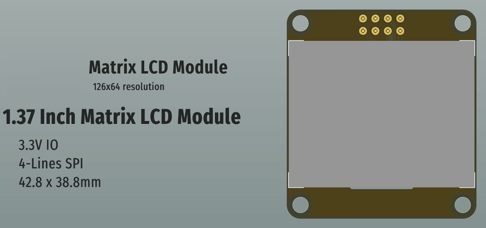

# Nuvoton M031TD2AE — 1.37" Matrix LCD Module (ST7567 / AiP31567)



Пример подключения и управления монохромным графическим LCD-модулем **128 × 64** на контроллере **ST7567** (совместимое обозначение модуля в документации WeActStudio — **AiP31567**). Используется микроконтроллер **Nuvoton M031TD2AE**, аппаратный интерфейс **SPI0** и среда **SEGGER Embedded Studio**.

За основу описания модуля взят проект [WeActStudio.MatrixLCDModule](https://github.com/WeActStudio/WeActStudio.MatrixLCDModule). Исходный код в этой папке — самостоятельный пример работы с периферией Nuvoton через регистры.

## Характеристики дисплея

| Параметр | Значение |
|---|---|
| Диагональ | 1,37 дюйма |
| Разрешение | 128 × 64 пикселя |
| Тип | Монохромный графический LCD |
| Контроллер | ST7567 / AiP31567 (по документации модуля WeActStudio) |
| Интерфейс | 4-проводный SPI с отдельным сигналом D/C |
| Габариты модуля | 42,8 × 38,8 мм (по данным WeActStudio) |
| Разъёмы | MX1.25 1×8 / 2×4, шаг 2,54 мм (по данным WeActStudio) |
| Питание в схеме данного примера | 3,3 В |
| Уровни GPIO микроконтроллера | 3,3 В |

> **Примечание.** Конкретные допустимые напряжения, распиновку разъёма и подключение подсветки следует сверять со схемой используемой ревизии модуля. В данном проекте питание и подсветка показаны подключёнными к 3,3 В.

## Подключение к M031TD2AE

| M031TD2AE | ST7567 / LCD | Назначение |
|---|---|---|
| `PA.0` | `MOSI` / `SDA` | Данные SPI0 (`SPI0_MOSI`, MFP=4) |
| `PA.2` | `SCLK` / `SCL` | Тактовый сигнал SPI0 (`SPI0_CLK`, MFP=4) |
| `PB.0` | `RES` / `RST` | Аппаратный сброс дисплея |
| `PB.1` | `D/C` / `A0` | Выбор команды или данных |
| `PB.2` | `CS` | Выбор устройства, активный низкий уровень |
| `3.3V` | `VCC` | Питание дисплейного модуля |
| `3.3V` | `BL` | Питание подсветки согласно используемой схеме |
| `GND` | `GND` | Общая земля |

```text
  Nuvoton M031TD2AE               LCD ST7567
  ------------------               ----------
  PA.0  (SPI0_MOSI)  ------------> MOSI / SDA
  PA.2  (SPI0_CLK)   ------------> SCLK / SCL
  PB.0  (GPIO)       ------------> RES / RST
  PB.1  (GPIO)       ------------> D/C  / A0
  PB.2  (GPIO)       ------------> CS
  3.3V               ------------> VCC
  3.3V               ------------> BL
  GND                ------------> GND
```

## Структура проекта

```text
012_LCD_Module( ST7567)/
├── README.md
├── 01_Examples_GraphicsTest/
│   └── 01_SPI_Init_main.c
├── 02_Images/
│   └── 001.jpg
└── 03_Hardware/
    ├── 1.37_MatrixLCD_DisplayModule SchDoc.pdf
    └── DisplayModule Board Shape.pdf
```

| Каталог | Описание |
|---|---|
| [`01_Examples_GraphicsTest`](01_Examples_GraphicsTest/) | Исходный пример инициализации SPI0 и проверки дисплея |
| [`02_Images`](02_Images/) | Фотография модуля |
| [`03_Hardware`](03_Hardware/) | Электрическая схема и чертёж платы дисплейного модуля |

## Пример `01_SPI_Init_main.c`

[Открыть исходный код](01_Examples_GraphicsTest/01_SPI_Init_main.c)

В программе реализованы:

1. Настройка системного тактирования от **HIRC 48 МГц**.
2. Назначение альтернативных функций `PA.0` и `PA.2` для аппаратного `SPI0`.
3. Настройка `PB.0`, `PB.1`, `PB.2` как цифровых выходов управления дисплеем.
4. Инициализация `SPI0` (ведущий режим, 8-битные передачи; делитель SPI в исходнике равен `11`).
5. Аппаратный сброс и инициализация контроллера ST7567.
6. Последовательная запись в **8 страниц** экранной памяти по **128 столбцов**.
7. Чередование двух тестовых изображений с задержкой приблизительно **1 секунда**:
   - горизонтальные полосы: байт `0xAA` в каждом столбце;
   - вертикальные полосы: чередование столбцов `0xFF` и `0x00`.

Работа с периферией ведётся через регистры и макросы `SET_BIT`, `CLEAR_BIT`, `READ_BIT`, `WRITE_REG`, `MODIFY_REG`. Для задержки используется `SysTick`; отдельная графическая библиотека не требуется.

### Порядок инициализации

```c
SYS_Init();       // Системное тактирование и альтернативные функции
LCD_GPIO_Init();  // GPIO управления LCD
SPI0_Init();      // Аппаратный SPI0
LCD_Init();       // Сброс и инициализация ST7567
```

### Результат тестирования

**Проверено на реальном оборудовании:** исходник успешно компилируется в SEGGER Embedded Studio, обе тестовые «зебры» правильно отображаются на ST7567 и переключаются примерно каждую секунду.

> Данный результат относится к конфигурации, указанной в исходном файле, и использованному автором аппаратному модулю.

## Среда разработки

- **Микроконтроллер:** Nuvoton M031TD2AE (Arm Cortex-M0).
- **IDE:** SEGGER Embedded Studio.
- **Заголовки устройства:** `NuMicro.h` из соответствующего пакета поддержки Nuvoton.
- **Язык:** C; низкоуровневая работа с регистрами без отдельного LCD HAL.

Для запуска добавьте [`01_SPI_Init_main.c`](01_Examples_GraphicsTest/01_SPI_Init_main.c) в проект SEGGER Embedded Studio для **M031TD2AE**, убедитесь, что доступен `NuMicro.h`, и подключите дисплей по таблице выше. Исходный файл содержит `main()` и предназначен для использования вместо другого файла с `main()` в проекте.

## Документация и первоисточники

- [WeActStudio — 1.37 Inch Matrix LCD Module](https://github.com/WeActStudio/WeActStudio.MatrixLCDModule)
- [Оригинальная документация ST7567 и AiP31567](https://github.com/WeActStudio/WeActStudio.MatrixLCDModule/tree/main/Doc)
- [Схемы и чертежи модуля в проекте WeActStudio](https://github.com/WeActStudio/WeActStudio.MatrixLCDModule/tree/main/Hardware)
- [Основной репозиторий с примерами для Nuvoton](https://github.com/PivnevNikolay/Segger_Embedded_Studio_for_Nuvoton)

## Авторы и благодарности

В заголовке исходного файла указаны:

- **ScuratovaAnna** — автор первоначального примера.
- **PivnevNikolay** — отладка кода.

Материалы о дисплейном модуле: **WeActStudio**.

**Документация:** README подготовлен при содействии **ChatGPT (OpenAI)** на основе исходного кода проекта и документации WeActStudio. Это указание на использование инструмента ИИ, а не на отдельного GitHub-пользователя или участника истории коммитов.

Этот README описывает конфигурацию и пример из репозитория **PivnevNikolay/Segger_Embedded_Studio_for_Nuvoton**, а не является копией официального README WeActStudio.
