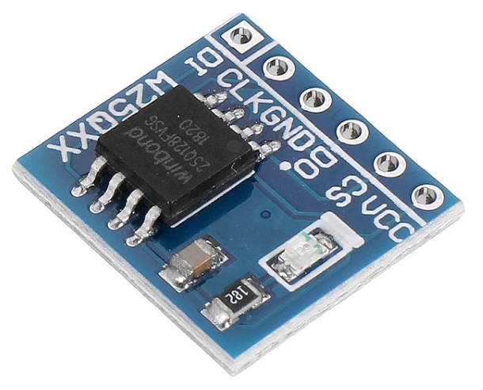
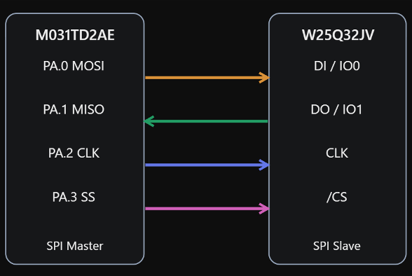
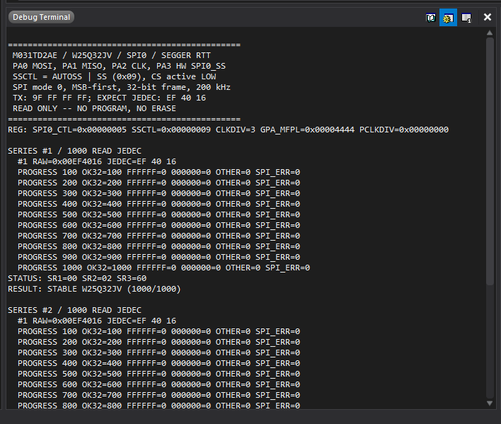

# Nuvoton M031TD2AE — SPI Flash Winbond W25Q32JV (SPI0 + SEGGER RTT)



Пример работы с последовательной NOR Flash **Winbond W25Q32JV** (32 Мбит / 4 МиБ) на микроконтроллере **Nuvoton M031TD2AE**. Для обмена используется аппаратный **SPI0** с **аппаратным сигналом выбора микросхемы SPI0_SS на PA.3**. Результаты теста выводятся в **SEGGER RTT** через интерфейс SWD/J-Link, без UART и LCD.

Программа обращается к периферии M031 преимущественно **непосредственно через регистры** (`NuMicro.h`); для вывода текста используются функции библиотеки SEGGER RTT. Тест безопасен для содержимого Flash: **программирования, стирания и изменения регистров состояния нет**.

## Характеристики W25Q32JV

| Параметр | Значение |
|---|---|
| Изготовитель | Winbond |
| Микросхема | W25Q32JV |
| Тип | Последовательная NOR Flash |
| Ёмкость | 32 Мбит = 4 МиБ (4 194 304 байта) |
| Интерфейс в данном примере | Стандартный 1-1-1 SPI, Mode 0, MSB first |
| JEDEC Read ID | Команда `0x9F`; ожидается `EF 40 16` |
| Чтение Status Register-1/2/3 | `0x05` / `0x35` / `0x15` |
| Напряжение питания схемы | 3,3 В |
| Микроконтроллер | Nuvoton M031TD2AE (Arm Cortex-M0) |
| Среда разработки | SEGGER Embedded Studio |
| Отладочный вывод | SEGGER RTT, Up Channel 0 |

> **Важно.** Физическая распиновка, питающее напряжение и необходимые подтяжки должны соответствовать конкретной установленной микросхеме и схеме платы. Для данной конфигурации используются логические уровни 3,3 В.

## Подключение к M031TD2AE

| M031TD2AE | W25Q32JV (SOIC-8) | Назначение |
|---|---|---|
| `PA.0` / `SPI0_MOSI` | `DI / IO0`, вывод 5 | Данные от MCU к памяти |
| `PA.1` / `SPI0_MISO` | `DO / IO1`, вывод 2 | Данные от памяти к MCU |
| `PA.2` / `SPI0_CLK` | `CLK`, вывод 6 | Тактовый сигнал |
| **`PA.3` / `SPI0_SS`** | **`/CS`, вывод 1** | **Аппаратный выбор Flash (активен LOW)** |
| `3.3V` | `VCC`, вывод 8 | Питание |
| `GND` | `GND`, вывод 4 | Общая земля |
| `3.3V` | `/WP / IO2`, вывод 3 | Неактивный `/WP` |
| `3.3V` | `/HOLD / IO3`, вывод 7 | Неактивный `/HOLD` |

```text
  Nuvoton M031TD2AE                Winbond W25Q32JV
  ------------------               ----------------
  PA.0 (SPI0_MOSI)  ------------->  DI / IO0   (5)
  PA.1 (SPI0_MISO)  <-------------  DO / IO1   (2)
  PA.2 (SPI0_CLK)   ------------->  CLK        (6)
  PA.3 (SPI0_SS)    ------------->  /CS        (1)
  3.3 V             ------------->  VCC        (8)
  GND               --------------  GND        (4)
  3.3 V             ------------->  /WP        (3)
  3.3 V             ------------->  /HOLD      (7)
```

**PC.0 в данном примере не используется.** Ранее испытывалось программное управление CS через GPIO, но проверенная конфигурация использует аппаратный `SPI0_SS` на `PA.3`.

## Структура каталога

```text
013_W25Q32JV/
├── README.md
├── 01_Examples_W25Q32JV/
│   └── 01_W25Q32JV_SPI0_PA3_AutoSS_RTT.c
└── 02_Images/
    ├── 001.jpg
    ├── 002.jpg
    ├── 003.jpg
    └── 004.jpg
```

Основной исходник: **[`01_W25Q32JV_SPI0_PA3_AutoSS_RTT.c`](01_Examples_W25Q32JV/01_W25Q32JV_SPI0_PA3_AutoSS_RTT.c)**.

## Принцип работы

1. Включается внутренний генератор **HIRC 48 МГц**, настраиваются HCLK/PCLK1 и тактирование SPI0.
2. Через `SYS->GPA_MFPL` назначаются функции `SPI0_MOSI`, `SPI0_MISO`, `SPI0_CLK` и **`SPI0_SS`** на PA.0–PA.3.
3. SPI0 сбрасывается и настраивается в **Master / Mode 0 / full-duplex / MSB first**.
4. `SPI0->SSCTL = SPI_SSCTL_AUTOSS_Msk | SPI_SSCTL_SS_Msk` включает **автоматический аппаратный CS**, активный низким уровнем.
5. Поле `DWIDTH = 0` задаёт **32-битную транзакцию**. Одним словом `0x9FFFFFFF` передаются команда `0x9F` и три фиктивных байта `0xFF`.
6. Из принятого `SPI0->RX` выделяются три байта JEDEC ID. Они сравниваются с ожидаемым `EF 40 16`.
7. Выполняется серия из **1000 чтений**, статистика поступает в SEGGER RTT каждые 100 операций.
8. В конце серии считываются **SR1, SR2 и SR3**; после паузы запускается следующая серия.

### Один кадр: Read JEDEC ID

```text
PA.3 /CS:     LOW на протяжении одной 32-битной транзакции
PA.2 CLK:     32 тактовых импульса

              |   8 бит  |   8 бит  |   8 бит  |   8 бит  |
MOSI (TX):    |    9F    |    FF    |    FF    |    FF    |
MISO (RX):    |    XX    |    EF    |    40    |    16    |
                                   \____ JEDEC ID ____/

SPI0->TX = 0x9FFFFFFF
SPI0->RX = 0xXXEF4016
```

`XX` — байт, одновременно полученный во время передачи команды; он **не входит в JEDEC ID**. В проверенном примере встречалось значение `RAW=0x00EF4016`.

Поскольку используется **один 32-битный кадр**, аппаратный CS удерживается активным на всём протяжении команды и ответа. При нескольких отдельных 8-битных транзакциях Auto-SS мог бы отпускать CS между кадрами.

### Ключевые регистры SPI0

| Регистр | Использование |
|---|---|
| `SPI0->CTL` | Включение SPI, полярность, фронты, размер кадра |
| `SPI0->CLKDIV` | Делитель тактовой частоты |
| `SPI0->SSCTL` | Аппаратное управление CS |
| `SPI0->FIFOCTL` | Сброс TX/RX FIFO перед запуском |
| `SPI0->STATUS` | Флаги `BUSY`, `RXEMPTY`, `TXFULL`, `RXOVIF`, `SPIENSTS`, `TXRXRST` |
| `SPI0->TX` | Передаваемое 32-битное слово |
| `SPI0->RX` | Принятое 32-битное слово |

Настройка аппаратного CS в файле:

```c
SPI0->SSCTL = SPI_SSCTL_AUTOSS_Msk | SPI_SSCTL_SS_Msk;

/* DWIDTH=0 => 32 бита; Master, Mode 0, MSB first */
SPI0->CTL = SPI_CTL_TXNEG_Msk | SPI_CTL_SPIEN_Msk;
```

Порядок инициализации важен: перед настройкой `CTL`, `CLKDIV`, `SSCTL` и `FIFOCTL` блок SPI отключается; после сброса FIFO программа дожидается снятия `TXRXRST`, а затем включает SPI и проверяет `SPIENSTS`.

> **Уточнение о частоте в текущей версии исходника.** В начале файла объявлено `#define SPI0_DIVIDER (239UL)`, однако непосредственно в `SPI0_Init_Registers()` записано **`SPI0->CLKDIV = 3`**. Согласно формуле из заголовка регистров Nuvoton `f_SCLK = f_SPI0 / (DIVIDER + 1)`, при источнике 48 МГц это **12 МГц**, а не 200 кГц. Комментарий возле записи делителя и текст приветствия RTT содержат другую частоту и должны быть согласованы с реальной настройкой. Для 200 кГц при 48 МГц необходимо значение `239`. **README описывает фактическое содержимое исходника и не изменяет его.** Частоту на конкретной плате полезно проверить логическим анализатором.

## Назначение функций исходника

| Функция | Назначение |
|---|---|
| `SYS_Init_Registers()` | HIRC 48 МГц, тактирование SPI0, мультиплексирование PA.0–PA.3 |
| `SPI0_Init_Registers()` | Сброс и настройка SPI0, FIFO, аппаратного Auto-SS |
| `SPI_WaitClear()` / `SPI_WaitSet()` | Ожидание аппаратных флагов с программным тайм-аутом |
| `SPI0_Transfer32()` | Один 32-битный полнодуплексный обмен; ровно одно чтение `SPI0->RX` |
| `Flash_ReadJEDEC()` | Команда `0x9F` и выделение трёх байтов JEDEC ID |
| `Flash_ReadStatus()` | Команды чтения SR1/SR2/SR3 |
| `Delay_ms()` | Задержка через регистры SysTick |
| `RTT_Text()` / `RTT_Hex8()` / `RTT_Hex32()` / `RTT_U32()` | Форматирование и передача отчётов в SEGGER RTT |
| `RTT_PrintID()` | Формирование строки с RAW и JEDEC ID |
| `main()` | Инициализация, повторяющиеся серии по 1000 чтений, подсчёт ошибок |

## SEGGER RTT: сборка и просмотр результатов

RTT (*Real-Time Transfer*) использует буфер в **SRAM микроконтроллера**, который считывает **J-Link через SWD**. Для диагностического вывода не нужны UART, LCD или отдельный провод TX.

В проект SEGGER Embedded Studio требуется добавить:

- `NuMicro.h` и стандартные файлы запуска/поддержки Nuvoton M031TD2AE;
- исходный файл примера **[`01_W25Q32JV_SPI0_PA3_AutoSS_RTT.c`](01_Examples_W25Q32JV/01_W25Q32JV_SPI0_PA3_AutoSS_RTT.c)**;
- `SEGGER_RTT.c` и `SEGGER_RTT.h` из RTT Target Package SEGGER; при необходимости — соответствующую конфигурацию `SEGGER_RTT_Conf.h`;
- пути к заголовочным файлам в настройках проекта.

`SEGGER_RTT_printf.c` в этом примере не требуется: используется непосредственный вызов `SEGGER_RTT_WriteString(0, ...)`.

После сборки и запуска отладки откройте **Debug Terminal** в Embedded Studio или **J-Link RTT Viewer** с подключением к существующей J-Link-сессии и просмотрите **Up Channel 0**.

Пример отправки строки:

```c
SEGGER_RTT_Init();
SEGGER_RTT_WriteString(0U, "JEDEC test started\r\n");
```

Если терминал пуст, проверьте: выполняется ли программа, подключён ли `SEGGER_RTT.c`, выбран ли канал 0, найден ли RTT Control Block в RAM и нет ли конфликта между двумя отладочными подключениями.

## Результат проверки на оборудовании

В ходе испытаний с **аппаратным SPI0_SS на PA.3** получен следующий вывод RTT (фрагмент реального теста):

```text
SERIES #12 / 1000 READ JEDEC
  #1 RAW=0x00EF4016 JEDEC=EF 40 16
  PROGRESS 100 OK32=100 FFFFFF=0 000000=0 OTHER=0 SPI_ERR=0
  PROGRESS 500 OK32=500 FFFFFF=0 000000=0 OTHER=0 SPI_ERR=0
  PROGRESS 1000 OK32=1000 FFFFFF=0 000000=0 OTHER=0 SPI_ERR=0
STATUS: SR1=00 SR2=02 SR3=60
RESULT: STABLE W25Q32JV (1000/1000)
```

- **JEDEC ID = `EF 40 16`**: микросхема распознана как W25Q32JV.
- **1000/1000 успешных чтений** в приведённой серии, без зафиксированных ошибок SPI.
- **SR1 = `00`**: бит BUSY = 0; память не выполняет операцию записи/стирания.
- **SR2 = `02`**: установлен бит QE (Quad Enable), который не препятствует стандартному SPI-чтению.
- **SR3 = `60`**: значение регистра состояния/конфигурации; детали битов см. в datasheet конкретной ревизии W25Q32JV.

**Статус:** тест JEDEC и чтения регистров состояния проверен на реальном оборудовании. Тест **не подтверждает** функции чтения массива памяти, программирования или стирания: эти операции в примере не выполняются.

## Изображения из проекта

Все иллюстрации берутся из существующего каталога [`02_Images`](02_Images/) этого проекта.

### Изображение 001


### Изображение 002


### Изображение 003


### Изображение 004


## Ограничения и возможное развитие

Текущая программа демонстрирует только безопасное чтение JEDEC ID и статусных регистров. Для команды `0x03` (*Read Data*) с произвольной длиной необходима отдельная реализация транзакции, удерживающая CS активным не только во время команды и 24-битного адреса, но и до завершения чтения массива данных. Нынешнюю 32-битную функцию нельзя без изменений использовать для длинного непрерывного чтения.

## Документация

- [Winbond — официальный сайт](https://www.winbond.com/)
- [SEGGER RTT — документация](https://kb.segger.com/RTT)
- [SEGGER J-Link RTT Viewer](https://kb.segger.com/J-Link_RTT_Viewer)
- [Примеры ST7567 для M031TD2AE (предыдущий раздел)](../012_LCD_Module(%20ST7567)/README.md)
- [Репозиторий SEGGER Embedded Studio for Nuvoton](https://github.com/PivnevNikolay/Segger_Embedded_Studio_for_Nuvoton)

## Авторы и благодарности

В заголовке исходного файла указаны:

- **ScuratovaAnna** — автор первоначальной идеи / примера.
- **PivnevNikolay** — отладка кода на оборудовании.

**Документация:** README подготовлен при содействии ChatGPT (OpenAI) по исходному коду из этого каталога и результатам аппаратных испытаний. Описание относится к версии проекта, доступной на момент подготовки документа.
